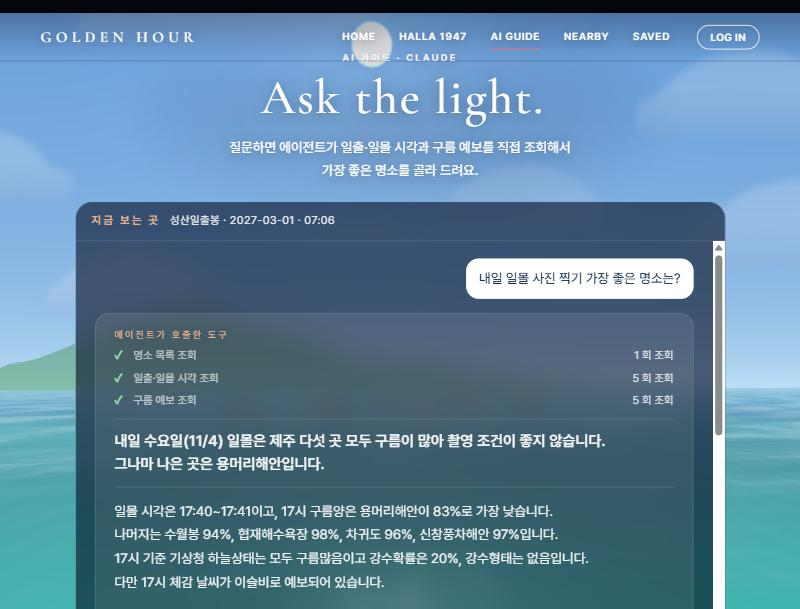
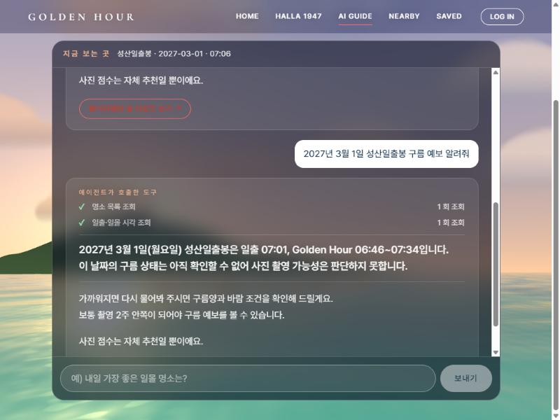

# GOLDEN HOUR — 제주 일출·일몰 사진 가이드

제주의 일출·일몰 명소를 실제 날씨 데이터로 비교하고, 3D 하늘과 바다로 보여 주고, AI 에이전트가 가장 좋은 곳과 시간을 골라 주는 웹앱입니다. 주변 관광지와 한라산 등반 날씨까지 함께 볼 수 있습니다.

**배포 주소:** https://project-flame-omega-mk9u3aq62v.vercel.app/

**기획 의도:** 제주의 바다와 빛을 사진으로 남기고 싶은 사람에게, 오늘 어디서 언제 찍으면 좋은지 실제 날씨 데이터로 알려 주는 일출·일몰 가이드입니다.

## 기술 스택

- **화면:** React (Vite), React Router, Zustand (전역 상태)
- **3D:** three.js (하늘·해·달·별·구름·바다, 한라산)
- **서버 함수:** Vercel `api/` 폴더 (로컬에서는 `vite.config.js` 플러그인이 같은 파일을 실행)
- **데이터 저장:** Supabase (즐겨찾기, 대화 기록, 로그인)
- **AI:** Claude (Anthropic) 에이전트, 도구 호출 방식

## 화면 구성

| 탭 | 하는 일 |
|---|---|
| **HOME** | 일출·일몰 명소 9곳을 구름양·풍속·비 가능성으로 비교합니다. 3D 하늘에서 해·달·별·구름이 시간에 따라 움직이고, 명소 카드를 누르면 그 명소의 일출·일몰 방향이 보입니다. 누른 자리에서 화면이 위로 튀지 않습니다. |
| **HALLA 1947** | 한라산 등반 날씨 판정기입니다. 성판악·관음사·어리목·영실 코스를 고르면 정상부 날씨를 좋음·주의·위험으로 판정하고, 일출·일몰에 맞춘 출발·하산 시각을 계산합니다. 3D 한라산, 북쪽이 위인 코스 지도, 시간별 날씨 표를 함께 보여 줍니다. 마우스를 움직이면 카메라가 살짝 옆으로 움직이지만, 산을 돌려 보는 기능은 없습니다. |
| **AI GUIDE** | 질문하면 Claude 에이전트가 일출·일몰 시각, 구름 예보, 한라산 날씨 도구를 스스로 골라 호출해 답합니다. 답변 위에 "에이전트가 호출한 도구" 목록이 나오고, 답변 아래 버튼으로 빛 리포트나 한라산 리포트 창을 열 수 있습니다. |
| **NEARBY** | 제주 지도에서 명소를 고르면 반경 3·5·10km 안의 관광지·음식점·행사를 보여 줍니다. 사진이 있는 곳이 먼저 나옵니다. |
| **SAVED** | 명소와 주변 장소를 즐겨찾기로 저장합니다. 로그인하면 내 계정에, 로그인하지 않으면 닉네임 기준으로 새로고침 후에도 남습니다. |

### HALLA 1947에 대해 알아 두실 점
- 3D 한라산은 실제 지형(DEM)이 아니라 정해진 난수로 만든 **개념적 시각화**입니다. 등산로 선도 장식용이며 실제 경로가 아닙니다.
- 코스의 거리와 소요 시간은 공식 자료로 확인하지 못해 화면에 표시하지 않습니다.
- 날씨 판정은 예보를 바탕으로 한 참고 정보입니다. 판정 기준은 `shared/hallasan.js`의 `RULES`에 있습니다.
- 입산 통제와 탐방 예약은 [한라산국립공원 공식 안내](https://www.jeju.go.kr/hallasan/index.htm)에서 확인해 주세요.

## 에이전트 (AI GUIDE)

Claude가 아래 도구를 질문에 맞게 골라 호출하고, 그 결과로 답합니다. 지어낸 숫자는 쓰지 않도록 시스템 지시를 두었습니다.

| 도구 | 하는 일 |
|---|---|
| `list_photo_spots` | 명소 목록과 좌표 |
| `get_sun_times` | 일출·일몰 시각 (sunrise-sunset.org) |
| `get_cloud_cover` | 시간별 구름양·날씨·풍속 (Open-Meteo, 기상청 단기예보) |
| `list_trails` | 한라산 코스 목록 |
| `get_elevation` | 좌표의 고도 |
| `get_mountain_weather` | 고도를 지정한 한라산 날씨와 등반 판정 |

답변 아래에는 명소의 빛 리포트나 한라산 리포트를 여는 버튼이 붙습니다.

## 에이전트 테스트 결과

**1. 여러 도구를 연속으로 호출하는 질문** — "내일 일몰 사진 찍기 가장 좋은 명소는?"

명소 목록, 일출·일몰 시각(5회), 구름 예보(5회)를 차례로 불러서 다섯 곳을 비교한 뒤 답합니다. 답변 위의 "에이전트가 호출한 도구" 목록이 실제 호출 내역입니다.



**2. 범위 밖 날짜를 물어 지어내지 않는지 확인하는 질문** — "2027년 3월 1일 성산일출봉 구름 예보 알려줘"

일출·일몰 시각은 알려 주지만, 구름 예보는 범위 밖이라 판단할 수 없다고 답합니다. 구름 숫자를 만들어 내지 않는 것을 확인했습니다.



## 알려진 한계

- **예보 범위:** 구름 예보는 오늘 기준 약 92일 전부터 15일 후까지만 나옵니다. 기상청 단기예보는 약 3일 안에서만 채워집니다. 범위 밖 날짜는 일출·일몰 시각만 알려 줍니다.
- **외부 API 실패:** sunrise-sunset.org가 응답하지 않으면 계산값으로 대신하고, 기상청이 실패하면 Open-Meteo만으로 판단합니다. 비짓제주 키가 없으면 주변 탐색은 안내 문구를 보여 줍니다.
- **행사 정보:** 비짓제주 API에는 폐업 정보가 없어서 지난 행사는 날짜로만 걸러냅니다. 실제로 문을 닫은 곳은 걸러지지 않을 수 있습니다.
- **한라산 3D:** 실제 지형이 아니라 개념적 시각화이고, 등산로 선도 실제 경로가 아닙니다.
- **한라산 거리·시간:** 공식 자료로 확인하지 못해 화면에 표시하지 않습니다.
- **AI 답변:** 모델이 가끔 요청한 문장 수를 넘기거나 표현이 달라질 수 있습니다. 사진 점수는 자체 추천이며 촬영 결과를 보장하지 않습니다.

## 사용한 API

| API | 용도 | 키 (환경변수) |
|---|---|---|
| 기상청 단기예보조회서비스 (공공데이터포털) | 공식 하늘상태·강수확률 | `DATA_GO_KR_KEY_KMA` |
| 한국관광공사 국문 관광정보 (공공데이터포털) | 명소 사진과 좌표 | `DATA_GO_KR_KEY_KTO` |
| 제주관광공사 비짓제주 관광정보 | NEARBY 의 관광지·음식점·행사 | `VISITJEJU_API_KEY` |
| sunrise-sunset.org v2 | 일출·일몰·골든아워·방위각 | 없음 |
| Open-Meteo (예보·바다) | 구름·풍속·파도, 한라산 고도 지정 예보 | 없음 |
| Claude (Anthropic) | AI 에이전트 | `ANTHROPIC_API_KEY` |
| Supabase | 즐겨찾기·대화 기록·로그인 | `VITE_SUPABASE_URL`, `VITE_SUPABASE_ANON_KEY` |

공공데이터 API 는 기상청, 한국관광공사, 비짓제주 세 개이고, 나머지는 보조로 씁니다.

## 데이터베이스 (Supabase)

`supabase/schema.sql`에 테이블과 정책이 있습니다.
- `favorites`: 명소 즐겨찾기
- `favorite_places`: 주변 장소 즐겨찾기
- `chat_logs`: AI 대화 기록

로그인 기능을 쓰려면 같은 파일의 "로그인" 부분을 Supabase SQL Editor에서 실행해야 합니다. 로그인은 아이디와 비밀번호로 하며, 데이터는 계정별로 나뉩니다.

## 실행

```bash
npm install
cp .env.example .env     # 값 채우기 (.env 는 .gitignore 에 들어 있음)
npm run dev              # 로컬 주소가 나오며, /api 서버 함수도 함께 실행됩니다
```

`npm run dev`는 `vite.config.js`의 `localApi` 플러그인이 `api/*.js`를 그대로 실행해 주므로 `vercel dev`가 필요 없습니다.

키가 없는 API는 그 부분만 꺼지고 나머지는 계속 동작합니다. 기상청은 Open-Meteo로 대체하고, 사진은 기본 배경을 쓰고, NEARBY는 안내 문구를 보여 줍니다.

## 폴더 구조

```
api/                  Vercel 서버 함수 (비밀 키는 여기서만 사용)
  agent.js              Claude 에이전트 루프 (MODEL 에서 모델을 고름)
  sun.js                일출·일몰
  weather.js            시간별 구름·풍속·파도 + 기상청
  nearby.js             주변 관광지 (비짓제주)
  tour.js               명소 사진 (TourAPI, 없으면 비짓제주)
  hallasan.js           한라산 등반 날씨 판정
server/               외부 API 호출과 에이전트 도구 정의 (5분 캐시)
shared/               화면과 서버가 함께 쓰는 값
  spots.js              명소 목록과 좌표
  score.js              구름 점수 기준표
  trails.js             한라산 코스
  hallasan.js           한라산 판정 기준(RULES)
  date.js               날짜 도구
src/
  pages/              Home · Halla · Hallasan · Agent · Nearby · Saved
  components/         SkyScene · TimeControl · SpotCard · InfoPanel · ScoreCard
                      ToolSteps · Lines · ReportModal · HallaReportModal
                      HallaRouteMap · JejuMap · AuthModal · Footer
  three/              createScene(하늘·해·달·바다·구름) · hallaScene(한라산)
                      dipper(북두칠성) · meteors(별똥별) · seaLife · silhouettes
  store/              Zustand 전역 상태 (로그인, 즐겨찾기, 대화, 선택한 명소)
  api/client.js       화면에서 /api 호출
  styles/theme.css    전체 디자인 (Pantone 올해의 색 팔레트)
supabase/schema.sql   테이블과 정책
scripts/find-coords.mjs   비짓제주·TourAPI 로 명소 좌표 후보 찾기
public/               파비콘, manifest, 앱 아이콘, OG 이미지
```

## 명소와 기준 바꾸기

- **명소 추가·수정:** `shared/spots.js`의 `lat`, `lng`를 채우면 화면과 에이전트에 자동으로 나타납니다. `null`이면 숨겨집니다. 좌표 후보는 `node --env-file=.env scripts/find-coords.mjs`로 찾을 수 있습니다. 현재 9곳 모두 좌표가 채워져 있습니다.
- **사진 점수:** `shared/score.js`의 `CLOUD_TABLE`과 `ADJUST`를 고치면 화면과 에이전트 답변 기준이 함께 바뀝니다.
- **한라산 판정 기준:** `shared/hallasan.js`의 `RULES`를 고칩니다.

## 배포 (Vercel)

1. GitHub에 올립니다. `.env`가 올라가지 않았는지 확인합니다.
2. Vercel에서 저장소를 Import하고, **Settings → Environment Variables**에 아래 값을 `.env`와 **같은 이름**으로 입력합니다. Production과 Preview 모두 체크합니다.

   | 이름 | 값 |
   |---|---|
   | `ANTHROPIC_API_KEY` | Claude 키 |
   | `DATA_GO_KR_KEY_KMA` | 포털 Decoding 키 (기상청) |
   | `DATA_GO_KR_KEY_KTO` | 포털 Decoding 키 (한국관광공사) |
   | `VISITJEJU_API_KEY` | 비짓제주 apiKey |
   | `VITE_SUPABASE_URL` | Supabase URL |
   | `VITE_SUPABASE_ANON_KEY` | Supabase anon 키 |

3. Deploy합니다. `VITE_`로 시작하는 값은 빌드할 때 들어가므로, 값을 바꾸면 Redeploy해야 반영됩니다.
